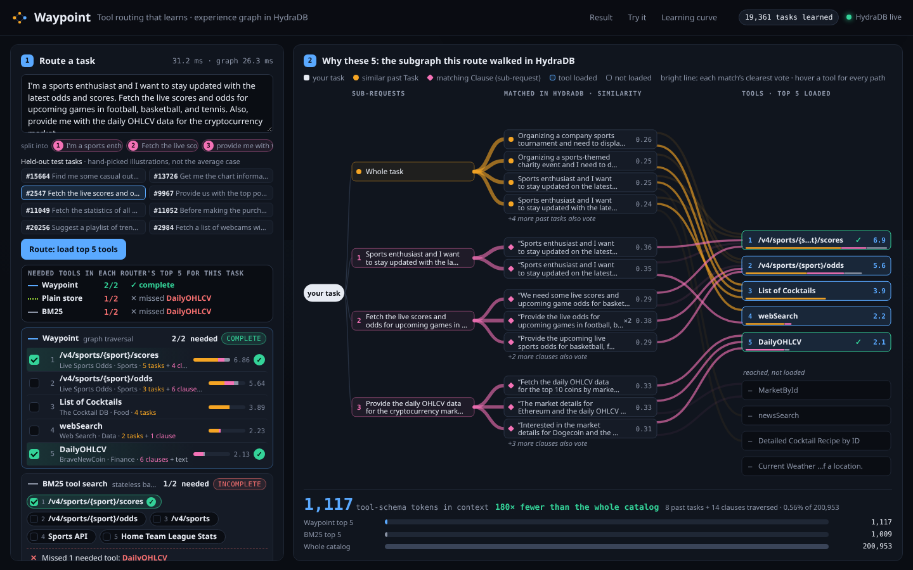

# Waypoint

**A drop-in MCP endpoint that serves 5 tools instead of 1,400, and learns from every run which 5 to serve.** Built for the HydraDB Hackathon, Track 2 (the agent context layer), on the open-source [HydraDB](https://github.com/hydra-db/hydradb) engine, self-hosted, as the graph database.

**Live app:** https://8000-cs6js0x7u8nbs6h8biw2kqrl2vyzobbf.capysandbox.net (see [live app and load](#live-app-and-load))
**Loom walkthrough:** {{LOOM_URL}}



The screenshot is one hand-picked illustration: a held-out task that Waypoint completes and both baselines miss. It is not typical; the representative numbers are the tables below.

## The problem

Agents with large tool catalogs either load every tool schema on every request (Anthropic cites 58 tools using about 55K tokens before the conversation starts) or use stateless tool search (BM25 or regex over descriptions) that misses tools a task needs together. One missing tool and the task fails, and neither approach learns from the runs the agent already did.

## What Waypoint does

HydraDB stores the tool catalog and the router's experience as a graph. A new task is split into sub-requests, matched against past tasks and past sub-requests, and a traversal in HydraDB follows `Task -USED-> Api` and `Clause -NEEDS-> Api` edges to the tools they needed. Only the top 5 schemas go to the agent, through a `/mcp` endpoint that any MCP client can use (`find_tools`, and `report_run` to write the outcome back). Each finished run writes new edges, so the router improves with use.

## Results

Metric: **Completeness@5**, the share of held-out tasks where every needed tool is among the 5 loaded. Data: ToolBench G3, COLT split, 1,419 real APIs; 2,373 test tasks that are never fed back; 19,361 training runs fed back. Every number comes from `eval/` and is listed with its method in [docs/results.md](docs/results.md).

| Router | Completeness@5 | Recall@5 |
|---|---|---|
| Stateless BM25 tool search (baseline) | 26.7% | 56.0% |
| Flat memory: copy the nearest past run's tools | 60.3% | 76.0% |
| Flat k-NN: Waypoint's scoring and candidate budget over whole past runs in plain dicts | 69.9% | 83.5% |
| **Waypoint** (experience graph in HydraDB) | **70.7%** | **84.1%** |

- **About 2.6x over stateless tool search**, and 713 tool-schema tokens per task against 200,953 for the whole catalog (282x fewer). The curve rises at every checkpoint: see [docs/img/waypoint-curve.svg](docs/img/waypoint-curve.svg).
- **Most of the gain is the learning loop.** On familiar tasks a budget-matched plain store is as good as the graph (78.5% against 78.2% on tool sets seen in training, 69.9% against 70.7% overall).

### Would it fall apart on a plain store?

On the tasks a plain store handles well, no difference. On the tasks it cannot, yes. A catalog keeps growing after launch, and a new endpoint has no past runs. We held out a random 10% of the catalog (142 APIs) from every training run and scored the test tasks that need one of them (561 tasks):

| Router | Tasks that need a new API | All tasks under the holdout |
|---|---|---|
| Stateless BM25 | 22.8% | 26.7% |
| Flat k-NN (plain store, same scoring and budget) | 1.8% | 55.1% |
| **Waypoint** | **24.2%** | **60.9%** |

The plain store collapses to 1.8% because its votes bury any tool nobody has used. Waypoint reaches the new endpoint through its Tool in the graph (`Api <-HAS_API- Tool -HAS_API-> Api`) and keeps about 24%, while keeping the learned gains elsewhere. Caveat, stated plainly: on new tools stateless BM25 is close behind (22.8%), so this shows the graph keeps the learning without losing new tools, not that it beats search by much there.

The graph also helps where a new catalog starts. On tool sets never seen in training Waypoint scores 42.9% against 38.4% for the plain store, and it reaches the same accuracy with roughly 40% to 60% fewer runs on that slice (and 11% to 52% fewer over all tasks; interpolated between checkpoints, so approximate).

### Live agent check

A real `gpt-5.4-mini` agent on 40 held-out tasks, one run, success meaning it called every tool the task needs: all 1,419 schemas preloaded 35.0% (183,962 input tokens per task), stateless search 17.5%, Waypoint through the real `/mcp` endpoint 50.0% at 2,905 input tokens (about 1/60), cost per task $0.0028 against $0.0173 preloaded. A budget-matched flat k-NN finder ties Waypoint (52.5%), so this check shows the token and success win over today's options, not a graph advantage. Waypoint needs about one more model round trip than preloading (3.52 against 2.35).

### Method notes

- Both flat baselines run on Python dicts, not in HydraDB, and a parity test shows the same traversal returns identical results either way, so the familiar-task accuracy comes from how the router learns, not from the engine. HydraDB is where the graph lives in production, and the new-API result above needs the graph structure.
- Feedback is simulated from the training labels (a finished run reports the tools it needed), the test labels never reach the graph, and COLT's tune file is never read because it is byte-identical to the test file.

## Live app and load

- The live demo runs on a single 4-CPU instance. Teach and feedback writes are not persisted, so they are lost when the instance restarts and the demo returns to its baked state.
- The documented self-host path is Render's free tier ([docs/deploy.md](docs/deploy.md), `infra/render/`): 0.1 CPU and 512 MB, a cold start of about 3 minutes kept warm by a ping every 5 minutes, and **much slower under concurrent use** (about 2 route requests per second, several seconds per query with a few users, no failed requests in testing).
- **Load test** ([docs/load.md](docs/load.md)), same image at 2 CPU: 56.6 route requests per second at 20 users, p50 150 ms, p95 280 ms, zero failures. At 0.1 CPU (Render's free tier): 1.8 requests per second at 5 users, p50 2.3 s, zero failures.
- Routing latency in the eval, 8 concurrent clients against one HydraDB node: p50 71.7 ms, p95 169.1 ms.

## Run it

Requires Docker and [uv](https://docs.astral.sh/uv/).

```bash
docker compose --profile app up --build     # HydraDB (pinned image) and the app on http://127.0.0.1:8000
# or, to reproduce the eval:
docker compose up -d --wait hydradb
uv sync
uv run python -m eval.run_eval               # about 3 minutes, writes eval/results/waypoint-test.json
uv run python -m eval.plot                   # eval/results/waypoint-test.svg
uv run python -m eval.report                 # refreshes the generated block in docs/results.md
```

The first run downloads the dataset (11 MB) into `data/`. `run_eval` wipes the graph's Task nodes before it starts, so do not point it at a live demo's HydraDB.

## Docs

- [docs/results.md](docs/results.md): results, slices, data efficiency, new-API holdout, live agent check, what we tried that did not help, eval protocol
- [docs/api.md](docs/api.md): HTTP API and the `/mcp` endpoint
- [docs/load.md](docs/load.md): load test profiles
- [docs/deploy.md](docs/deploy.md) and `infra/render/`: deploy (Render free tier; Fly.io and Railway variants kept)
- [docs/gtm.md](docs/gtm.md) and [docs/pitch.md](docs/pitch.md): who buys it and the pitch; [docs/loom-script.md](docs/loom-script.md): the walkthrough script
- [docs/decision-log.md](docs/decision-log.md), [docs/recommendation.md](docs/recommendation.md), [docs/hydradb-notes.md](docs/hydradb-notes.md): how we got here

## License

MIT, see [LICENSE](LICENSE). HydraDB is a separate project under its own license; it is pulled as a pinned Docker image and not vendored here.
