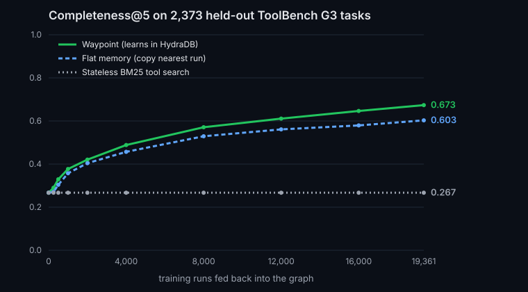

# Results

Waypoint routes an agent's task to the few tools it needs, and learns from every finished run. Each run is written into HydraDB as a `Task` node with `USED` edges (tools the run needed) and `REJECTED` edges (tools offered but not needed). The run is also split into its sub-requests, one `Clause` node per sentence, and each needed tool is linked to the sub-request it served: `(:Task)-[:HAS_CLAUSE]->(:Clause)-[:NEEDS]->(:Api)`. A new task enters the graph twice. The whole task matches similar past Tasks and follows their `USED` edges. Each of its sub-requests matches similar past Clauses and follows their `NEEDS` edges. Then each candidate's learned outcome counters on its Api node are applied.

## Headline

All numbers below come from `eval/run_eval.py` against a running HydraDB. The generated block is written by `eval/report.py` from `eval/results/waypoint-test.json`.

- **Metric**: Completeness@5, the share of held-out tasks where **every** tool the task needs is among the 5 tool schemas loaded into the agent's context. If one tool is missing, the agent cannot finish the task.
- **Baseline**: stateless BM25 tool search over tool descriptions. This is the mechanism behind today's tool-search features, and it's the same index Waypoint uses to find entry points.
- **Stronger baseline**: flat memory, a plain key-value store of past runs that copies the nearest past run's tools and pads the rest with BM25. It gets the same runs and the same k.
- **Budget-matched baseline**: flat k-NN memory. It uses Waypoint's scoring, weights and candidate counts (30 lexical tools, the 8 nearest past runs, the 6 nearest past runs per sub-request) over a key-value store of whole runs. The only thing it lacks is the graph's structure: no `Clause -NEEDS-> Api` links (each sub-request match pulls in that past run's whole tool set) and no rejection counters. It gets the same runs, the same k, and Waypoint's validation-tuned weights unchanged.

<!-- BEGIN generated by eval/report.py -->

Dataset: ToolBench G3, COLT split (hf.co/datasets/Tool-COLT/ToolBenchG3). 2,373 held-out test tasks, 19,361 training runs fed back, k = 5. Generated 2026-11-16T06:08:09+00:00.

| Router | Completeness@5 | Recall@5 |
|---|---|---|
| Stateless BM25 tool search (baseline) | 26.7% | 56.0% |
| Flat memory: copy the nearest past run's tools | 60.3% | 76.0% |
| Flat k-NN memory: Waypoint's weights and candidate budget over whole past runs | 69.9% | 83.5% |
| **Waypoint** (experience graph in HydraDB) | **70.7%** | **84.1%** |

Learning curve (Completeness@5 on the same held-out tasks after each batch of runs):

| Runs fed back | BM25 | Flat memory | Flat k-NN | Waypoint |
|---|---|---|---|---|
| 0 | 26.7% | 26.7% | 26.7% | 26.7% |
| 250 | 26.7% | 27.1% | 23.4% | 32.0% |
| 500 | 26.7% | 30.4% | 28.6% | 36.3% |
| 1,000 | 26.7% | 35.7% | 35.4% | 41.3% |
| 2,000 | 26.7% | 40.4% | 41.0% | 46.6% |
| 4,000 | 26.7% | 45.7% | 49.6% | 53.1% |
| 8,000 | 26.7% | 52.9% | 59.6% | 61.2% |
| 12,000 | 26.7% | 56.1% | 63.9% | 64.9% |
| 16,000 | 26.7% | 57.9% | 66.8% | 68.2% |
| 19,361 | 26.7% | 60.3% | 69.9% | 70.7% |

Slices at the end of the stream (Completeness@5):

| Slice | Tasks | BM25 | Flat memory | Flat k-NN | Waypoint |
|---|---|---|---|---|---|
| Tool set seen in training | 1,865 | 27.8% | 67.8% | 78.5% | 78.3% |
| Tool set never seen in training | 508 | 22.8% | 32.7% | 38.4% | 42.9% |

Data efficiency: training runs fed back before each router first reaches a Completeness@5 level (linear interpolation between the checkpoints above; Waypoint against the budget-matched flat k-NN):

| Tasks | Level | Flat k-NN | Waypoint | Runs saved |
|---|---|---|---|---|
| All | 40.0% | 1,823 | 868 | 52% |
| All | 50.0% | 4,160 | 3,051 | 27% |
| All | 60.0% | 8,347 | 7,395 | 11% |
| Tool set never seen in training | 25.0% | 4,857 | 2,000 | 59% |
| Tool set never seen in training | 30.0% | 8,757 | 3,451 | 61% |
| Tool set never seen in training | 35.0% | 14,878 | 9,017 | 39% |
| Tool set never seen in training | 40.0% | not within 19,361 | 15,556 | n/a |

Context cost: Waypoint loads 714 tool-schema tokens per task on average, against 200,953 for the whole catalog (281x fewer).

Route latency during the eval, 8 concurrent clients against one HydraDB node: p50 92.5 ms, p95 200.0 ms.

<!-- END generated by eval/report.py -->



## What the numbers say

- Waypoint more than doubles stateless tool search, and the curve rises with every batch of runs. It isn't a one-off number: the table above has ten checkpoints, all measured on the same untouched held-out tasks.
- Waypoint beats the nearest-run cache at every checkpoint. Most of that gap is retrieval budget, not graph structure: the budget-matched flat k-NN gets 69.9% against Waypoint's 70.7% at the end of the stream, and on tool sets seen in training it is level (78.5% vs 78.3%).
- What the graph structure adds is measured by Waypoint against flat k-NN, and it shows up where it should: on tasks whose exact tool set never appeared in training, 42.9% against 38.4%, and early in the stream (32.0% vs 23.4% after 250 runs, 53.1% vs 49.6% after 4,000). A whole past run carries tools the new task doesn't need, while a `Clause -NEEDS-> Api` edge carries only the tools that sub-request used, so Waypoint can assemble a new set from parts of different runs. Early in the stream most endpoints have no runs yet, and the Tool transfer (next section) reaches them through their Tool. That is most of the early-curve gap. The gain on the full stream is real but modest, and we report it at that size.
- The structure pays off most in data efficiency, which is what a new deployment lives on: a team's private tool catalog starts with no runs. On tool sets never seen in training, both routers start at the BM25 score with zero runs and dip below it early (next bullet), so the levels in the table are all above that starting point. Waypoint reaches 25% Completeness@5 after 2,000 runs and 30% after 3,451, where flat k-NN needs 4,857 and 8,757 (59% and 61% fewer runs). Flat k-NN doesn't reach 40% on that slice within 19,361 runs; Waypoint does at 15,556. Over all tasks the saving is 52% at the 40% level and shrinks to 11% at 60%. These come from interpolating between checkpoints, so read them as approximate.
- One weakness the curve shows: with only a few hundred runs, both learned routers score below stateless BM25 on novel tool sets, because a handful of loosely matching past runs outvote the text match. Waypoint passes BM25 on that slice by 1,000 runs, and flat k-NN only between 2,000 and 4,000. Waypoint stays ahead of flat k-NN at every checkpoint. The nearest-run cache, which votes with a single run, is ahead of Waypoint on novel tool sets only at 250 runs, and level at 2,000.
- What the comparison does and doesn't isolate: both flat baselines run on Python dicts, not in HydraDB. The same traversal run on Python dicts returns exactly what HydraDB returns (`tests/test_store_integration.py` asserts that parity), so the accuracy comes from how Waypoint learns from its experience graph, not from the database engine. HydraDB is where that graph lives and is traversed live: persistent, shared by every agent that routes through it, and four traversals per route.
- What we tried that didn't help: expanding through co-used tools (`Api <-USED- Task -USED-> Api`), a query-weighted version of the same, and expanding to every sibling endpoint of the same Tool. All three lowered validation Completeness@5, so none of them ships (decision log). The Tool transfer that does ship is narrower: it only reaches endpoints with no runs yet. The rejection-weighted outcome counters change validation Completeness@5 by less than one point (0.682 with them off, 0.688 at 0.3, 0.689 at 0.6), so we keep them at 0.3. We don't claim a measurable gain from them. Regenerate these with `uv run python -m eval.run_eval --split val --limit 800 --w-rej 0` (or 0.3, 0.6).

## New Apis with no past runs

A catalog keeps growing after a router goes live. An endpoint added today has no runs, so a store of past runs has nothing to copy for it. This eval simulates that: a seeded 10% of the Apis is held out of every training run, and every run that used one is dropped. The held-out Apis stay in the catalog with their `Tool` and `Category` edges, but no run has used them. Generated by `eval/cold_start.py` from `eval/results/cold-start-test.json`:

<!-- BEGIN cold-start generated by eval/report.py -->

142 of the catalog's Apis (10%, seed 7) are held out of every training run, leaving 14,819 of 19,361 runs. Store: hydradb. Generated 2026-11-16T05:58:14+00:00.

| Router | Needs a new Api (561 tasks) | Familiar (1,812) | All (2,373) | New Apis in the top 5 |
|---|---|---|---|---|
| Stateless BM25 tool search | 22.8% | 27.9% | 26.7% | 54.4% |
| Flat memory: copy the nearest past run | 23.0% | 62.8% | 53.4% | 45.0% |
| Flat k-NN memory (budget-matched) | 1.8% | 71.6% | 55.1% | 2.5% |
| Waypoint without the Tool transfer | 3.0% | 72.5% | 56.1% | 5.6% |
| **Waypoint** | 24.2% | 72.2% | 60.9% | 37.2% |

<!-- END cold-start generated by eval/report.py -->

- Both routers that learn from past runs collapse on tasks that need a new Api. Their experience votes bury an endpoint that nobody has used yet, and stateless BM25 does better on that slice.
- Waypoint's Tool transfer is the fix, and it needs the graph. When a learned Api gets votes, the router follows `(:Api)<-[:HAS_API]-(:Tool)-[:HAS_API]->(:Api)` to endpoints of the same Tool whose `used` counter is still 0. Such an endpoint gets a share of the learned vote when the task's text matches it at least as well as the voted endpoint. The "used" state on the Api node is written by the learning loop, so the transfer switches off on its own as soon as a run uses the new endpoint.
- The weights (`w_new = 0.5`, `new_tau = 0.3`, top 10 learned candidates) were tuned on the validation slice only, with the same held-out Apis (`eval/results/cold-start-val.json`, in-memory store). The router uses the transfer on every route, so it's also in the headline numbers above.
- An earlier version that expanded to every sibling endpoint lowered accuracy (see below). The version that ships only reaches endpoints with no runs yet, and only when the text matches them at least as well.

## Live agent check

A small real-agent run on Track 2's claim, generated by `eval/agent_check.py` from `eval/results/agent-check.json`. The same model and system prompt are used in every condition, with a mocked `call_api`. Success means the agent called every tool the task needs. Waypoint was served through its real `POST /mcp`.

<!-- BEGIN agent-check generated by eval/report.py -->

40 held-out test tasks, model gpt-5.4-mini, one run. Total spend 1.02 USD.

| Agent's tool access | Success | Mean input tokens | Model round trips | Tool calls | Cost per task (USD) |
|---|---|---|---|---|---|
| All 1,419 schemas preloaded | 35.0% | 183,962 | 2.35 | 2.85 | 0.0173 |
| Stateless search (BM25 top 5) | 17.5% | 3,955 | 4.17 | 4.72 | 0.0030 |
| Flat k-NN finder (budget-matched, no graph) | 52.5% | 2,704 | 3.38 | 3.77 | 0.0025 |
| Waypoint /mcp find_tools | 50.0% | 2,905 | 3.52 | 4.05 | 0.0028 |

Waypoint against flat k-NN, task by task: both succeed on 20, Waypoint only on 0, flat k-NN only on 1.

<!-- END agent-check generated by eval/report.py -->

- A finder that learns from past runs is the win here. It succeeds about three times as often as stateless search and more often than an agent with the whole catalog in its prompt, at about 1/60 of the input tokens.
- This run shows no graph advantage. The budget-matched flat k-NN finder ties Waypoint. 36 of the 40 sampled tasks have a tool set that was seen in training, which is exactly where flat memory is as good as the graph (see the seen-tool-set slice above).
- The preloaded agent needs fewer model round trips, because it picks its APIs in one shot. A finder costs about one extra call.
- This version of the run used the router before the Tool transfer shipped. The 40 sampled tasks were not re-run.

## Eval protocol

- Sub-request split: a task is cut at sentence ends and at "also", "additionally", "furthermore" and "moreover". Each tool a run needed is assigned to the sub-request whose text matches the tool's description best (BM25). Only training runs, and live runs taught through the API, are ever split and written.
- Data: ToolBench G3, COLT split (hf.co/datasets/Tool-COLT/ToolBenchG3), with 1,419 real RapidAPI endpoints. The 21,361 training tasks are shuffled once with seed 7. 2,000 of them become a validation slice, and the remaining 19,361 are the stream of runs fed back. The 2,373 test tasks are only ever routed. Their labels are used for scoring and never written into the graph.
- COLT's `query_tool_tune.txt` is byte-identical to its test file, so it is never read. All tuning (the router weights in `hydrahack/router.py`, the rejection weight) used the validation slice.
- The loop: at each checkpoint, the router serves the next batch of training tasks with its current graph. Each run's outcome (needed tools, plus offered tools that weren't needed) is written back, and then every test task is routed and scored. Flat memory gets the same runs at the same checkpoints.
- Feedback is simulated from the training labels: a successful run reports the tools it used, which is what a production router would log. No LLM is involved, so every number is deterministic and free to regenerate.

## Reproduce

```bash
docker compose up -d --wait hydradb          # HydraDB v0.4.0 (pinned image)
uv sync
uv run python -m eval.run_eval               # about 3 minutes, writes eval/results/waypoint-test.json
uv run python -m eval.plot                   # eval/results/waypoint-test.svg
uv run python -m eval.report                 # refreshes the block above
uv run python -m eval.run_eval --split val   # validation slice used for tuning
uv run python -m eval.cold_start             # new Apis with no past runs (test split, HydraDB)
uv run python -m eval.cold_start --split val --memory   # the validation run used for tuning
uv run python -m eval.agent_check            # live agent check (needs OPENAI_API_KEY and the app on :8000)
```

The first run downloads the dataset (11 MB) into `data/`. `run_eval` wipes the graph's Task nodes and their counters before it starts, so don't point it at the live demo's HydraDB.
